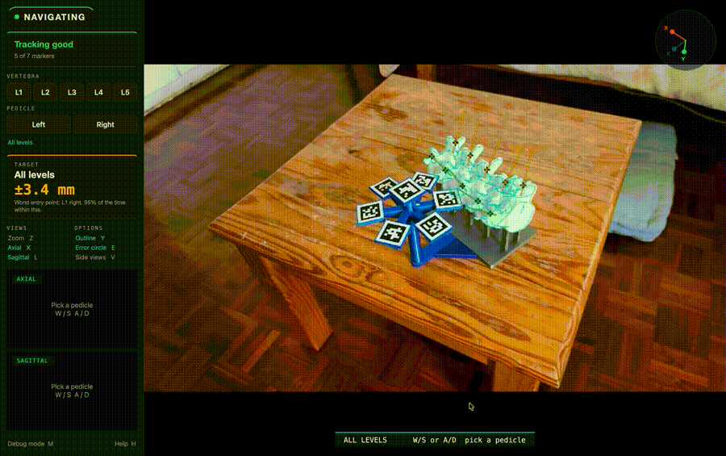
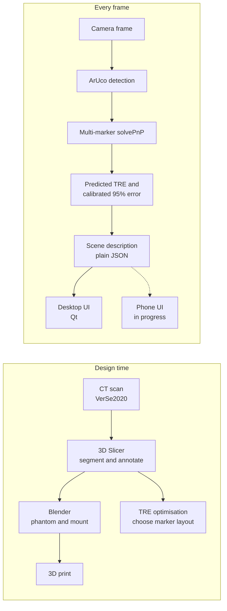
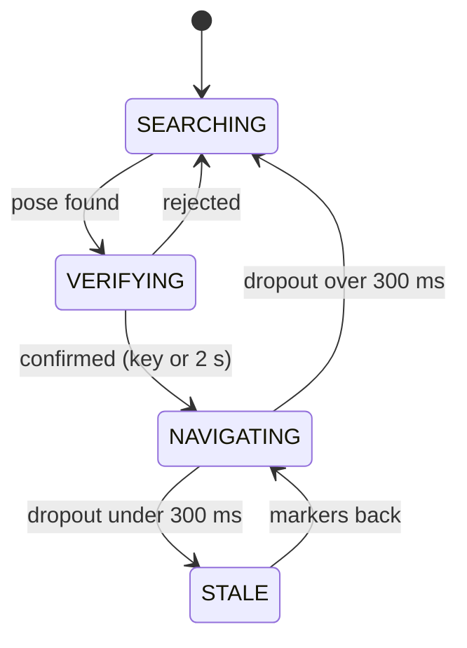
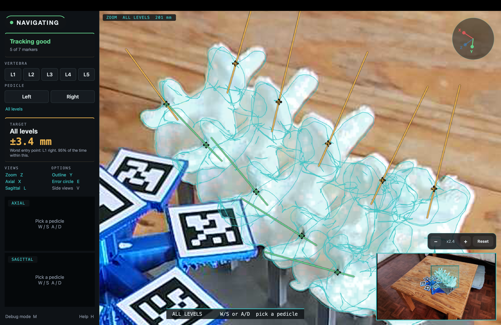
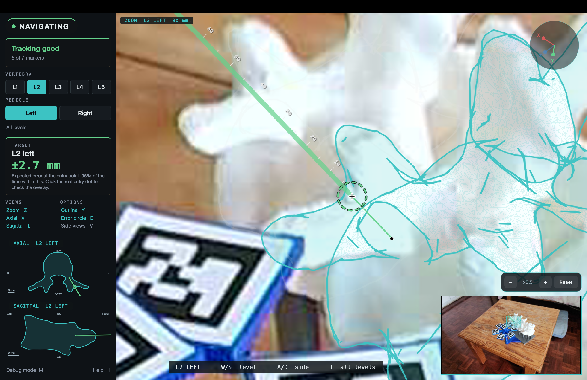
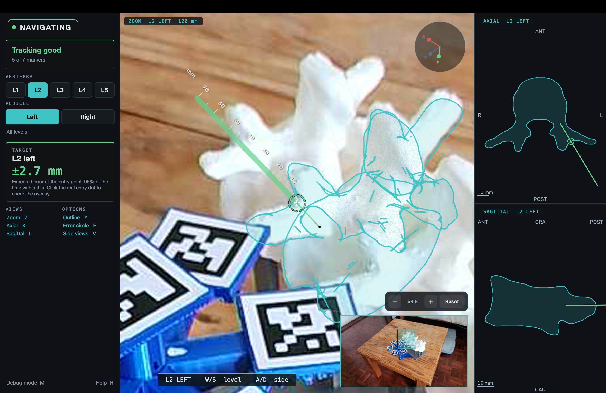
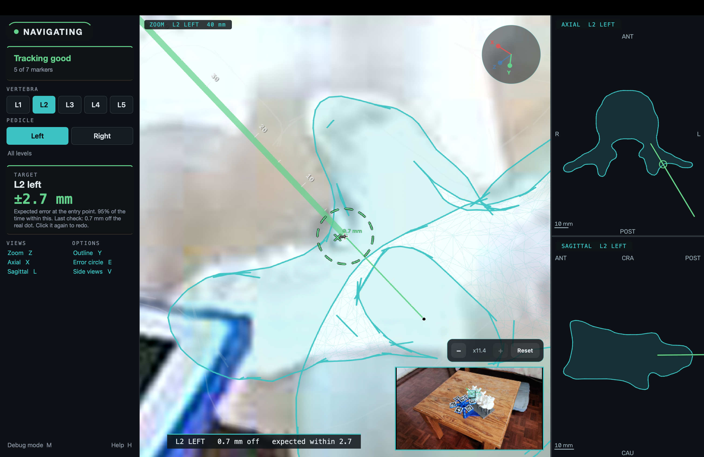
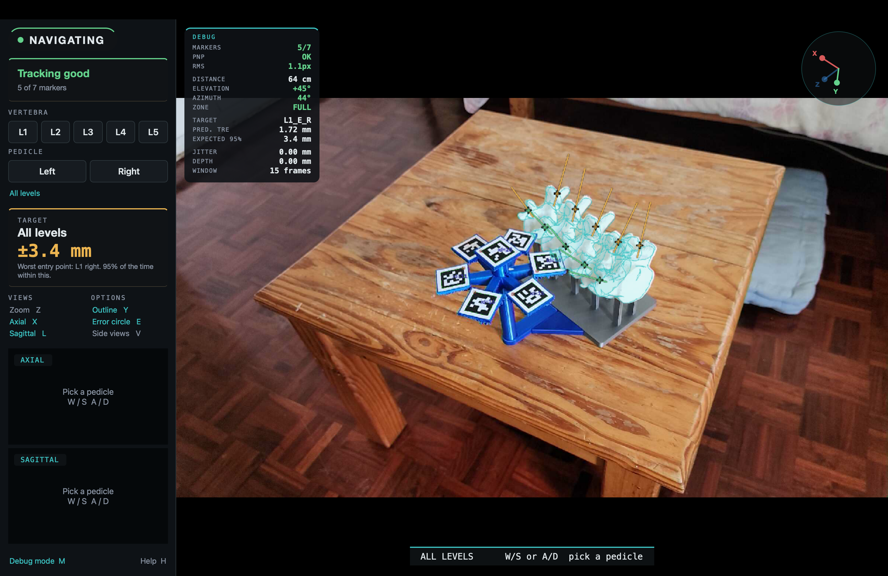
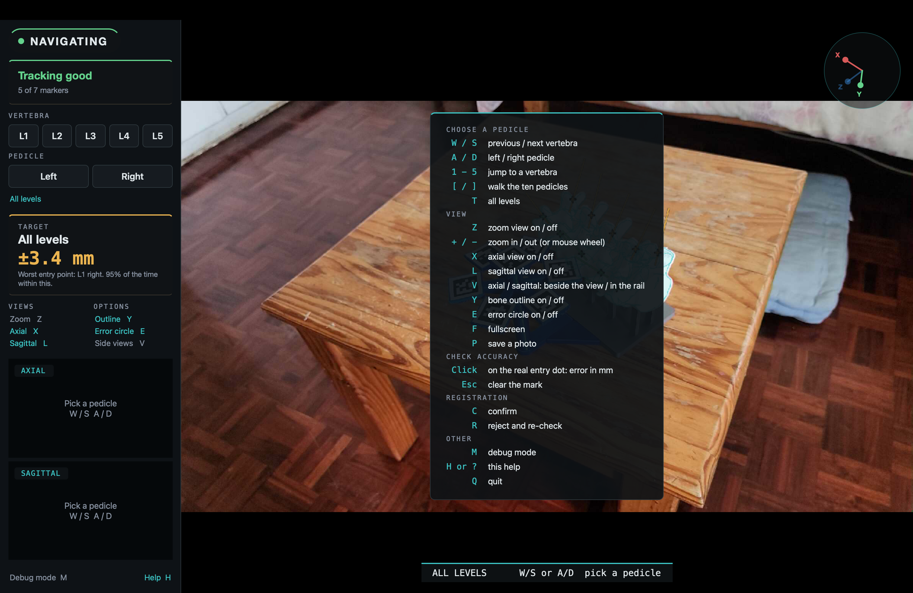

<div align="center">

# Fiducial-Based AR Registration for Rigid-Body Surgical Navigation

**A camera, a few printed markers and a 3D model of the spine, turned into a live overlay that shows where a pedicle screw should go, and how far to trust it.**


-41CD52?logo=qt&logoColor=white)




[Aim](#-aim) · [How it works](#-how-it-works) · [Interface tour](#-interface-tour) · [Results](#-results-at-a-glance) · [Quick start](#-quick-start) · [Keys](#-keys) · [Repo layout](#-repo-layout) · [Roadmap](#-roadmap)

</div>

---

## 🎯 Aim

Design, implement and evaluate a marker-based augmented reality registration pipeline for pedicle screw guidance on a 3D-printed L1 to L5 lumbar phantom, targeting a **mean target registration error (TRE) below 2 mm** and an **angulation error below 2°**.

Two contributions:

1. **A marker layout chosen by mathematics, not by eye.** The fiducial layout is optimised once, in simulation, to minimise the predicted TRE at all ten pedicle targets (Fitzpatrick's TRE theory used as a design tool, then checked with a Monte Carlo simulator).
2. **An overlay that says how much to trust itself.** The expected overlay error is drawn at the target, graded green, amber or red, instead of reporting one accuracy figure after the fact.

## 🧩 Deliverables

- [x] CT-derived spine model (VerSe2020), segmented per vertebra, with bilateral pedicle entry and isthmus targets
- [x] 3D-printed L1 to L5 phantom with a rigid reference mount (P1: L-bracket, P2: dome)
- [x] Camera calibration and a live registration pipeline (ArUco, multi-marker `solvePnP`, mesh overlay)
- [x] TRE optimisation and simulation tools for choosing the marker layout
- [x] Real-time, toggleable uncertainty overlay
- [x] Evaluation against eight acceptance test procedures (ATPs)
- [x] Surgeon-oriented laptop interface (UI v2) with unit tests
- [ ] Standalone phone version (in progress, see [Roadmap](#-roadmap))
- [x] Final report, poster and presentation

## ⚙️ How it works



Tracking runs as a small state machine, so the overlay is only drawn when the pose is trustworthy:



**Expected error.** The calibrated 95% radius is `r95 = 1.731 × sqrt(RMS_ref² + max(0, TRE² − TRE_ref²))`, anchored to the measured overlay error of each prototype. The ring is green up to 3.0 mm, amber up to 4.0 mm, and red beyond that or outside the pose envelope.

## 🖥️ Interface tour

The interface is built around one question: *can the overlay be trusted right now, for the pedicle in front of me?* Everything else is optional and one key away.

<details open>
<summary><b>Overview: all ten pedicles</b></summary>



All entry points with the worst expected error in the target card. The rail on the left holds the state pill, trust badge, pedicle selector, target card and view toggles.
</details>

<details>
<summary><b>One pedicle, zoomed</b></summary>



Picking a pedicle opens a magnified view with the trajectory, the true-scale error circle and the camera view as an inset with a crop box. Zoom steps with + and −.
</details>

<details>
<summary><b>Multi-view: axial and sagittal slices</b></summary>



The planned trajectory cut through the vertebra mesh, in the axial and sagittal planes. The slices sit in a column beside the main view, or in the rail (V).
</details>

<details>
<summary><b>Click to check</b></summary>



Clicking the real entry dot measures the in-plane overlay error in millimetres, pins a mark to the phantom and appends a row to `click_checks.csv`.
</details>

<details>
<summary><b>Debug mode and help</b></summary>

 

Debug mode (M) shows markers, reprojection RMS, pose, predicted TRE and rolling pose jitter. Help (H) lists every key.
</details>

## 📊 Results at a glance

ATP results for **P1 (L-bracket)**, from the report. The P2 (dome) results are in the report as well.

| Test | Result |
|---|---|
| Registration quality | Reprojection RMS 0.87 to 0.90 px |
| Wrong-side pose flips | 0 of 24,358 frames |
| Overlay accuracy (criterion: mean error under 2 mm) | **1.58 mm** at crisp focus (95% interval 1.26 to 2.04) |
| Full-accuracy envelope | 55 to 100 cm, azimuth 30 to 55°, elevation 10 to 35° |
| Occlusion | Mean TRE under 2 mm down to 5 visible markers |
| Frame rate | 30.4 FPS with overlay |
| End-to-end latency | 182 ms (SD 43) |
| Repeatability | Reprojection RMS CV 3.4%, pose scatter 0.59 mm |

## 🚀 Quick start

```bash
git clone https://github.com/<user>/EEE4022S-AR-Spine-Registration.git
cd EEE4022S-AR-Spine-Registration
python -m venv venv && source venv/bin/activate
pip install opencv-contrib-python numpy PySide6 Pillow pytest
```

**Replay saved frames (no camera or phantom needed):**

```bash
python scripts/registration/live_ar_overlay_qt.py --source data/screenshots/atp2_crisp
```

**Live, with a phone as the camera over USB:**

```bash
adb forward tcp:8080 tcp:8080          # with IP Webcam running on the phone
python scripts/registration/live_ar_overlay_qt.py --source http://localhost:8080/video
```

**Useful flags:** `--log run.csv` (per-frame ATP log), `--scene-log run.jsonl` (one scene per frame), `--screenshot-dir <dir>`.

**Run the tests:**

```bash
pytest tests
```

## ⌨️ Keys

<details>
<summary><b>Full key map</b></summary>

| Key | Action |
|---|---|
| `W` `S` or `↑` `↓` | Previous or next level |
| `A` `D` or `←` `→` | Left or right pedicle |
| `1` to `5` | Jump to level |
| `[` `]` | Walk through the ten pedicles |
| `T` or `0` | All levels |
| `Z` | Zoom view on or off |
| `+` `−` or scroll | Zoom steps |
| `X` | Axial slice |
| `L` | Sagittal slice |
| `V` | Move the slice views between the side column and the rail |
| `Y` | Outline on or off |
| `E` | Error circle on or off |
| click | Check the overlay against the real entry dot |
| `C` / `R` | Confirm or reject the registration |
| `F` | Fullscreen |
| `P` | Save a photo (clean frame, pose and scene) |
| `M` | Debug mode |
| `H` or `?` | Help |
| `Esc` | Clear a check or close help |
| `Q` | Quit |
</details>

## 🗂️ Repo layout

```
EEE4022S-AR-Spine-Registration/
├── annotations/            pedicle entry and isthmus targets (Slicer markups)
├── phantom/                Blender file, STL meshes, per-vertebra overlay meshes
├── data/                   calibration, marker maps, ATP captures
├── scripts/
│   ├── calibration/        printable boards, capture, camera calibration
│   ├── registration/       live pipeline and Qt interface (ar_*.py, ui/)
│   ├── tre_analysis/       Fitzpatrick TRE, Monte Carlo, design variants
│   └── atp/                acceptance test tools and analysis
├── tests/                  unit tests (pytest)
└── docs/                   figures and screenshots
```

Pipeline modules are small and single-purpose: `ar_tracker` (detection, pose, state machine), `ar_error` (calibrated error and grades), `ar_scene` (the per-frame scene description), `ar_selection` (which pedicle), `ar_jitter` (rolling pose wobble) and `ar_check` (click-to-check geometry). A module table is in [`scripts/registration/README.md`](scripts/registration/README.md).

## 🛣️ Roadmap

- [x] Laptop UI v2: pedicle selection, zoom, axial and sagittal views, click-to-check, debug mode
- [x] Scene description as plain JSON, so other front ends reuse the logic
- [x] Unit tests for the logic layer
- [ ] **Phone version** (Kotlin, CameraX, OpenCV Android): detection and pose on the phone, then the surgeon-facing UI
- [ ] Trust badge driven by measured pose jitter (thresholds from dome captures)
- [ ] Ghost screw preview along the planned trajectory
- [ ] Head-mounted display (AR glasses) as the end goal; out of scope for this project

## ⚠️ Limitations

This is a research prototype evaluated on a 3D-printed phantom. It is not a medical device, has no clinical or cadaveric validation, and must not be used for patient care. Click-to-check errors are in-plane: a single click cannot resolve depth along the viewing direction.

## 🙏 Acknowledgements

Supervised by Prof Fred Nicolls, Department of Electrical Engineering, University of Cape Town. Anatomical data from VerSe2020 (sub-verse835). Marker and TRE theory builds on Fitzpatrick et al. and Garrido-Jurado et al.; the 1.6 mm insertion point benchmark is from Xu et al. (2020).

Licensed under the MIT licence.